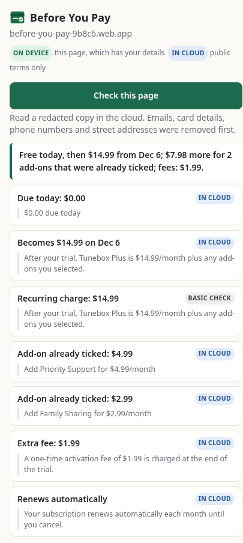

# Before You Pay

A Chrome side panel that reads a checkout or signup page before you click the button, and tells you what you are actually agreeing to: when the free trial turns into a charge, which paid add-ons were already ticked for you, what fees are hiding in the small print, whether it renews on its own, and where the cancel link is.

The page you are about to pay on has your name, email and card on it, so that page is read by Gemini Nano on your own machine. The store's public terms page has nothing about you on it, so that one goes to Gemini in the cloud to pull out the steps for cancelling later. Both run through Firebase AI Logic.

Live app: https://before-you-pay-9b8c6.web.app
Demo store (fake, made for this project): https://before-you-pay-9b8c6.web.app/demo-store/



## Why

Free trials that quietly convert, add-ons that are ticked by default and fees in grey 9px text are old tricks. In the US, the FTC's 2024 click-to-cancel rule was vacated by a federal appeals court in July 2025, and as of November 2026 nothing has replaced it, so the burden is still mostly on the person paying. Reading every checkout page carefully takes time most people do not spend, and pasting a page full of your own card and address details into a chatbot is not a good habit either. Running the model on the device is what makes this tool reasonable to use on exactly the pages where it matters.

## What it does

1. You open a checkout page and press **Check this page**.
2. A fast basic check (plain pattern matching, no model) shows cards right away.
3. Gemini Nano reads the page on your device and returns structured findings: due today, trial length and the price after it, recurring charges, pre-ticked paid add-ons, fees, auto-renewal and cancel links.
4. Every finding has to quote the page word for word. The code checks that the quote and the amount really appear on the page. Anything that does not match is marked "check this line" instead of being shown as fact. Dates are worked out in code, never by the model.
5. Click a card and the sentence it came from is highlighted on the page.
6. **Read the cancellation terms** sends the public terms page (not your checkout page) to Gemini in the cloud and returns the steps to cancel, the notice period and the refund policy.
7. **Remind me** sets a browser reminder two days before the first charge and saves a short "proof of offer": the verified quotes, the site, the date and a SHA-256 fingerprint, so you have a record of what you were promised.

If the on-device model is not available (older Chrome, unsupported hardware, or turned off by policy), the panel says so and asks before anything leaves the machine. If you agree, it sends a copy with emails, card details, phone numbers and street addresses removed first. Names are not reliably removed, and the panel says that too. Or you can stay with the basic check.

## How hybrid inference is used

| Page | Has personal details? | Firebase AI Logic mode | Why |
|---|---|---|---|
| Checkout or signup page | Yes | `ONLY_ON_DEVICE` (Gemini Nano through the Chrome Prompt API) | Card, email and address should not leave the laptop |
| Same page, after you agree | Redacted | `ONLY_IN_CLOUD` | Fallback when Nano is not available, only with consent |
| Public terms page | No | `ONLY_IN_CLOUD` | Long legal text, nothing private, cloud model does it better |

The modes are picked on purpose for each request instead of using one `PREFER_ON_DEVICE` setting for everything, because the right choice depends on what is in the text, not only on what the device can run. On device, the output is constrained with a JSON schema through `responseConstraint`. In the cloud, the same shape is enforced with `responseJsonSchema`. The panel shows where each card came from (ON DEVICE, IN CLOUD or BASIC CHECK) using the `inferenceSource` that Firebase AI Logic returns.

Other Firebase pieces:

- **App Check** with reCAPTCHA Enterprise protects the AI Logic calls, using limited-use tokens. Localhost uses the debug provider.
- **Anonymous Auth** and **Firestore** store saved offers under `users/{uid}/proofs`. The rules allow only the owner to read or delete, never allow edits, and check every field's type and size, including each quote.
- **Remote Config** holds the cloud model name, a kill switch for on-device use, the page size limit and how many days before the charge to remind you.
- **Hosting** serves the panel, the demo store and the eval page.

## Architecture

```
Chrome side panel (extension, MV3)
  └─ iframe: https://before-you-pay-9b8c6.web.app/panel.html   allow="language-model"
        ├─ Gemini Nano on device  ── checkout page text, links, ticked boxes
        ├─ Gemini in the cloud    ── public terms page, or a redacted copy with consent
        ├─ App Check, Auth, Firestore, Remote Config
  ├─ content script: reads the page, highlights quotes
  └─ background: reminder alarms and notifications
```

Extension pages cannot load reCAPTCHA, which App Check needs. So the side panel hosts the web app in an iframe and the two talk over `postMessage`. Both sides check the exact origin: the hosted page only accepts messages from this extension's ID, and the hosting server only lets the panel be framed by this extension (`frame-ancestors`). The Prompt API is passed into the iframe with `allow="language-model"`.

## Does it work? The eval

There are 16 made-up checkout and signup pages for fictional businesses (streaming, meal kits, gym, VPN, hotel, concert tickets and more), each labeled by hand. Three of them have no subscription at all, to catch false alarms. How they were labeled: [web/public/eval/LABELING.md](web/public/eval/LABELING.md). Anyone can run it at https://before-you-pay-9b8c6.web.app/eval.html.

| Run | Amount precision | Amount recall | Trial correct | Auto-renew correct | Cancel link correct | Findings that failed the quote check |
|---|---|---|---|---|---|---|
| Basic check (no model) | 0.68 | 0.39 | 1 of 3 | 0.75 | 1.00 | 0 |
| Cloud, redacted copy (v2) | 0.86 | 0.94 | 3 of 5 | 0.94 | 0.94 | 0 |
| On device (Gemini Nano) | not run yet | | | | | |

Notes, so the numbers are read fairly:

- "Trial correct" counts pages where a trial was labeled or reported. The cloud run reports a trial on two pages where there is none. f05 charges $1 for the first month and then $17 a month, and f07 has "50% off your first week". Both are intro prices, not free trials. These are real model mistakes and are left in.
- An earlier cloud run (v1, in `eval/results-cloud-v1.json`) scored trials as 1 of 4 because of a bug in the scorer: it looked at the first trial card it found, which was usually the basic check's card without a price. Fixing that, plus merging duplicate cards, gave v2. The prompts and rules were not changed to chase eval misses.
- The on-device numbers need a laptop that can run Gemini Nano. The machine this was built on has the model blocked by policy.
- 16 pages is small. This is a sanity check, not a benchmark.

Raw results are in [eval/](eval/).

## Privacy

- The checkout page is only read by the on-device model, unless you agree to send a redacted copy.
- Nothing is sent anywhere until you press a button.
- Saved offers keep verified quotes only, after the same redaction, capped at 10 quotes of 500 characters.
- Remote Config has a switch to turn off on-device use without shipping a new version.
- There are no analytics.

## Run it yourself

You need Node 20+, the Firebase CLI and Chrome 139 or newer on desktop.

```bash
cd web
npm install
npm run dev        # http://localhost:5173/panel.html
npm test           # unit tests and the basic-check eval
```

On localhost, App Check uses a debug token. The first run prints one in the browser console. Add it in the Firebase console under App Check, Apps, Manage debug tokens. Do not commit it.

To use your own Firebase project, change the values in `web/src/config.ts` (the web config is public by design) and the project ID in `scripts/deploy.sh`, then:

```bash
./scripts/deploy.sh                 # Hosting, Firestore rules, Remote Config
cd rules-test && npm install && npm test   # Firestore rules tests (needs Java for the emulator)
```

### Load the extension

1. Open `chrome://extensions`, turn on Developer mode, click **Load unpacked** and pick the `extension` folder.
2. Open any checkout page (or the demo store) and click the Before You Pay icon.

The extension points at the hosted app. For local work, copy `extension/app-url.example.js` to `extension/app-url.js` and change the URL.

### Turn on Gemini Nano

1. Chrome 139+ on Windows, macOS or Linux with enough memory and a GPU (see [Chrome's hardware requirements](https://developer.chrome.com/docs/ai/get-started)).
2. In `chrome://flags`, search for "Prompt API", enable it, and restart Chrome.
3. In DevTools on any page, `await LanguageModel.availability()` should say `available` or `downloadable`. The first **Check this page** click starts the download.

## Repo layout

```
extension/     Chrome extension: side panel shell, content script, reminders
web/           Hosted app (Vite + TypeScript): panel, demo store, eval page
  src/ai.ts        Firebase AI Logic models and prompts
  src/verify.ts    quote and amount checks, date math
  src/rules.ts     the basic check
  src/redact.ts    redaction before anything goes to the cloud
  src/store.ts     saved offers (Auth + Firestore)
  public/eval/     16 labeled test pages
firestore.rules    owner-only, create-only, size-checked
rules-test/        emulator tests for the rules
eval/              eval results
scripts/           deploy, live check and eval runners
```

## Limits

- Gemini Nano on the web is single-turn and text only, so the page is turned into plain text plus a list of links and ticked boxes. Prices drawn as images are missed.
- Redaction is pattern based. It will miss some things, which is why the consent message says so.
- The basic check is English only.
- Reminders live in the browser. Saved offers sync through Firestore, but signing in on another device is not built yet.

## License

Apache 2.0. See [LICENSE](LICENSE).
