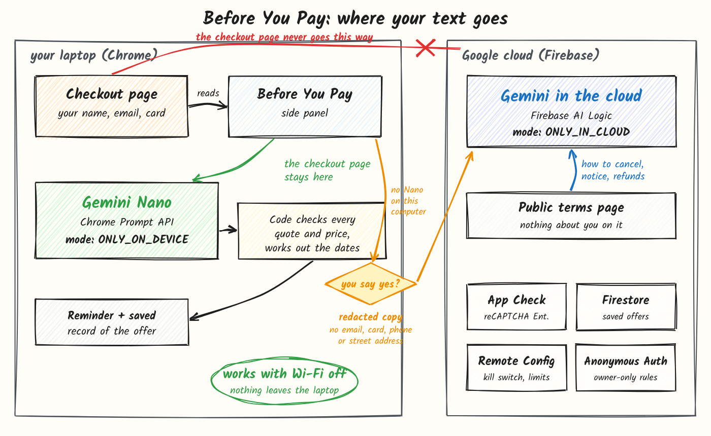
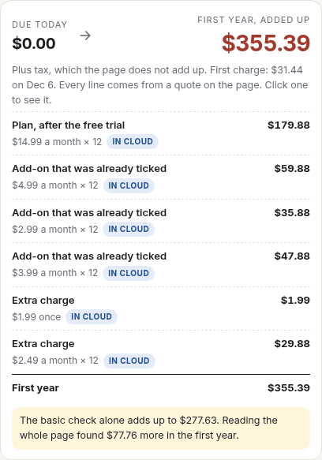
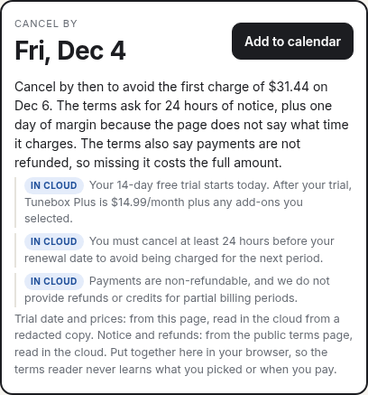
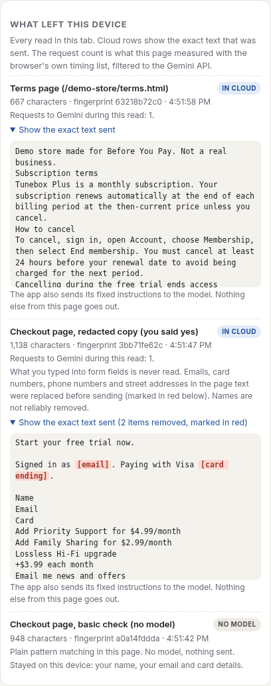
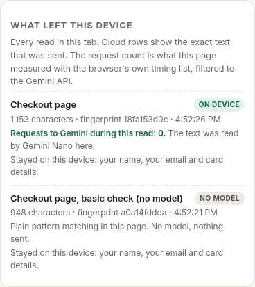
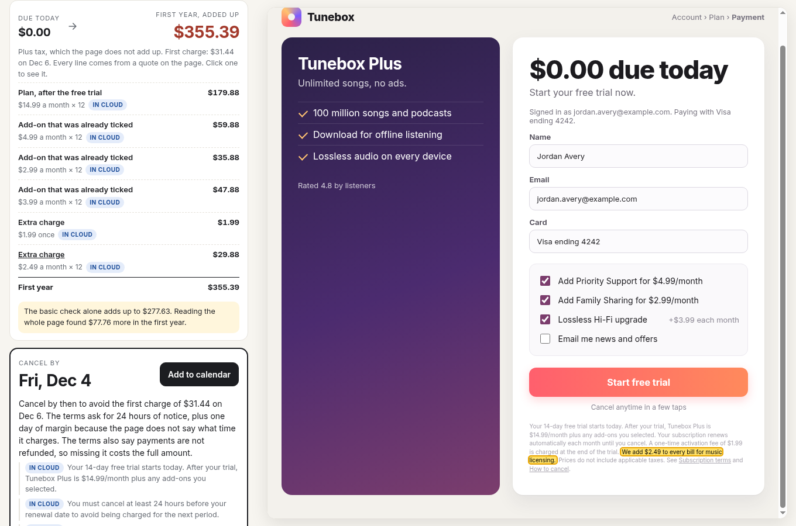
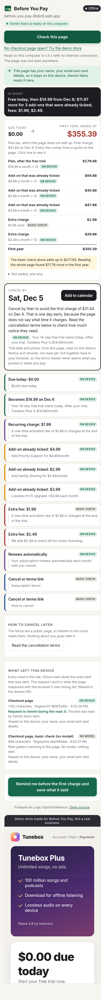
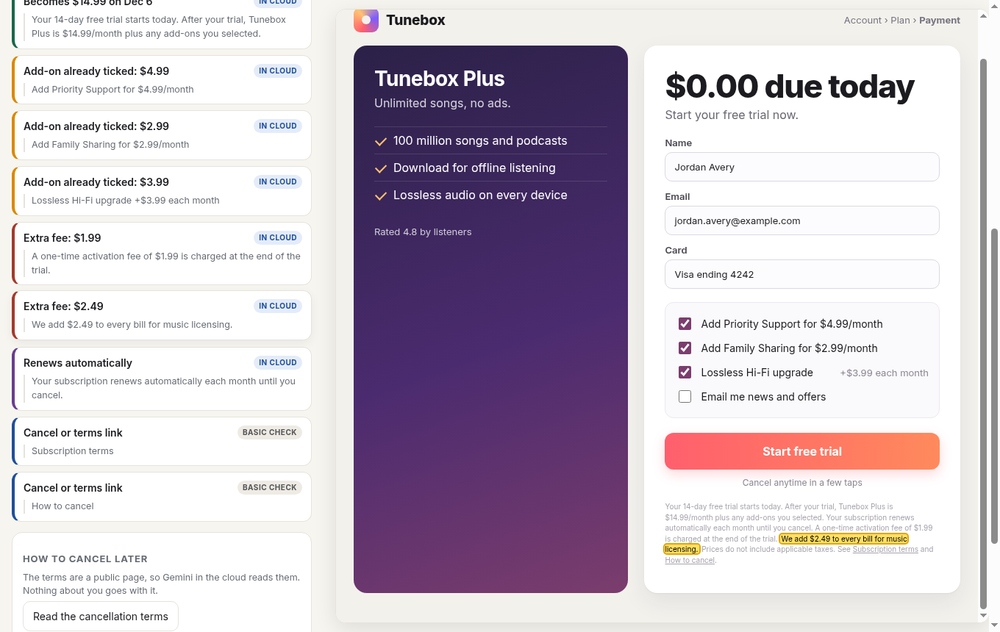
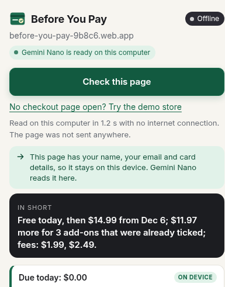

# Before You Pay

A Chrome side panel that reads a checkout page before you click the button, and tells you what you are really agreeing to: when the free trial turns into a charge, which paid add-ons were already ticked for you, what fees sit in the small print, whether it renews on its own, and how to cancel.

**The page you are about to pay on has your name, email and card on it, so it never leaves your laptop.** Gemini Nano reads it on the device, and the read is built to work with Wi-Fi off (tested so far with a stand-in for Nano, see below). The store's public terms page has nothing about you on it, so that one goes to Gemini in the cloud. Both run through Firebase AI Logic, and the app picks the mode for each request based on how private the text is.



Live app: https://before-you-pay-9b8c6.web.app
Demo store (fake, made for this project): https://before-you-pay-9b8c6.web.app/demo-store/

## Three things you only get from a hybrid read

The checkout page is private, so it is read on your device. The terms page is public, so the cloud reads it. Each half alone is a normal AI feature. Joining them on your device, where the cloud never sees the checkout page, is what this app does that I have not seen elsewhere.

**1. The first-year cost, added up.** "$0.00 due today" turns into "$355.39 in your first year, plus tax" on the demo store. Every line is a verified quote from the page, the billing period is read from the words next to each price ("each month", "every bill", "one-time"), and the math is plain code ([web/src/cost.ts](web/src/cost.ts)). Click a line and the words are marked on the page. It also says what the model added: the basic check alone gets to $277.63, because it cannot see the add-on whose price sits outside its checkbox or the $2.49 that never says "fee". A page that lists several plans gets no total instead of a guess, and anything without a clear period is listed as "not added".



**2. Cancel by a date, not a feeling.** The trial end date and the first bill come from the checkout page. The notice period and refund rule come from the terms page. They are put together in the browser ([web/src/deadline.ts](web/src/deadline.ts)): trial ends Dec 6, the terms ask for 24 hours notice, the page never says what time it charges, so the panel says **cancel by Fri, Dec 4**, the first charge would be $31.44, and the terms say payments are not refunded. The notice and refund lines only count if they are really on the terms page: Gemini's quotes are checked first, and if Gemini did not quote them, the terms text is searched in code (labeled BASIC CHECK). **Add to calendar** builds an .ics file in the browser with the quotes in it. Nothing is sent to make it.



**3. A receipt for what left your device.** Every read in the tab is listed with its mode, its size and a SHA-256 fingerprint. Cloud rows show the exact text that was sent, with what redaction removed marked in red, so you can see "[email]" and "[card ending]" where your details were. Each row also counts requests to the Gemini API made during that read, measured by the page itself with the browser's resource timing list ([web/src/receipt.ts](web/src/receipt.ts)). That is what the page can see, not a network capture, and the panel says so. With Nano the checkout row reads "Requests to Gemini during this read: 0".

| A cloud read of a redacted copy | The on-device row (stand-in for Nano, see below) |
|---|---|
|  |  |

The screenshots of the cost and cancel-by cards come from fresh cloud reads (redacted copy plus terms) on my machine. The on-device row comes from the stand-in run described in the next section, not from real Nano.



## The Wi-Fi off test

This is the test I care about most. Open the side panel on a checkout page, turn Wi-Fi off, and press **Check this page**. The status line says "Read on this computer in N s with no internet connection. The page was not sent anywhere." Every card the model wrote is marked ON DEVICE (the basic check's cards say BASIC CHECK). Then press **Read the cancellation terms** and the panel tells you that part needs the cloud and will wait until you are back online.



How that screenshot was made, honestly: the machine I built this on has Gemini Nano blocked by policy. So [scripts/offline-check.mjs](scripts/offline-check.mjs) loads the live panel page, swaps in a stand-in for Chrome's `LanguageModel`, goes offline and presses Check. The stand-in replays a real Gemini answer for the demo store (the saved cloud read in `web/public/demo-cache.json`), so the cards are real model output for this page, just not produced by Nano on this machine. It shows that once the panel is open, the app and the Firebase AI Logic SDK run the whole read with `ONLY_ON_DEVICE` and send nothing over the network. (The only request Chrome logged while offline was Firestore closing its idle connection.) It does not test the real model, and the 1.2 seconds in the screenshot is the stand-in's fixed delay, not a real timing. Real Gemini Nano runs and numbers are coming from a laptop that supports it.

## Try it in two minutes

1. Open https://before-you-pay-9b8c6.web.app/panel.html and press **No checkout page open? Try the demo store**, then **Check this page**.
2. The chip under the title tells you if Gemini Nano is ready on your computer.
3. Without it, you get the basic check plus a consent box. Press **Send a redacted copy** to see the cloud read, then **Read the cancellation terms**.
4. With Chrome 139+ and the Prompt API turned on (steps below), the same button reads the page on your device and the cards say ON DEVICE.

| No on-device model: it asks first | After a cloud read of a redacted copy (the saved answer from a real read, as its status line says) |
|---|---|
|  |  |

On a wide screen the hosted demo opens the store next to the cards, and clicking a card marks the exact words on the store page:



The two screenshots in the table are the real extension running against the live app. Compare the summary lines: the basic check finds 2 ticked add-ons and one fee, and Gemini also finds the third add-on, whose price sits outside its checkbox label, and a $2.49 charge that never uses the word "fee".

## Why

Free trials that quietly convert, add-ons that are ticked by default and fees in grey 10px text are old tricks, and people notice them too late. In its final click-to-cancel rule (October 2024), the FTC wrote that it "receives tens of thousands of complaints about negative options each year through its Sentinel complaint database" ([final rule, Section II](https://search.ftc.gov/system/files/ftc_gov/pdf/p064202_negative_option_rule.pdf)). The FTC's announcement of that rule put the daily average at 42 complaints in 2021 and nearly 70 in 2024 (as [reported by PYMNTS](https://www.pymnts.com/legal/2024/ftc-publishes-final-rule-on-subscription-and-membership-programs/) the same day; I could not load the original release on ftc.gov to link it). The rule was then vacated by a federal appeals court in July 2025, and as far as I can find, nothing has replaced it as of November 2026, so the burden is still mostly on the person paying.

The people I built this for: anyone signing up for a free trial or an intro price on a streaming, news or software site, which is most of us. In the real-page study below, 8 of the 10 public plan pages had a free trial or an intro price in their text.

Reading every checkout page carefully takes time most people do not spend, and pasting a page full of your own card and address details into a chatbot is not a good habit either. Running the model on the device is what makes this tool reasonable to use on exactly the pages where it matters.

## What it does

1. You open a checkout page and press **Check this page**.
2. A fast basic check (plain pattern matching, no model) shows cards right away.
3. Gemini Nano reads the page on your device and returns structured findings: due today, trial length and the price after it, recurring charges, pre-ticked paid add-ons, fees, auto-renewal and cancel links. A one line summary sits on top.
4. Every finding has to quote the page word for word. The code checks that the quote and the amount really appear on the page, and anything that does not match is marked "check this line". This catches made-up text and numbers. It does not catch a real sentence that the model reads wrong, so a few readings are also checked in code. Two such checks so far: a "trial" only counts as a free trial if the text around it says free, $0 or no charge, or says trial without a paid intro price nearby. Otherwise "$1 for your first month" is shown as the regular price after an intro offer, with a note. And an auto-renew card whose quote says "no automatic renewal" is marked "Not confirmed". Dates are worked out in code, never by the model.
5. Click a card and the words it came from are highlighted on the page, in the extension and in the hosted demo (where the demo store opens next to the cards). When the quote sits in one run of text only those words are marked; when it spans several elements, like a checkbox row, the smallest element holding it is outlined.
6. **Read the cancellation terms** sends the public terms page (not your checkout page) to Gemini in the cloud and returns the steps to cancel, the notice period and the refund policy. The lines Gemini quoted are checked against the terms page and shown under the steps. If none of them are on the page, the answer is marked "Not confirmed".
7. **Save** keeps a short record of the offer: the verified quotes, the site, the date and a SHA-256 fingerprint of them. When there is a free trial with a known end date, the same button also sets a browser reminder two days before the first charge. Clicking the reminder opens the site, where you can cancel.

Right when you press a button, the panel says where the text is going and why, in one line based on what is actually on the page. For example: "This page has your name, your email and card details, so it stays on this device. Gemini Nano reads it here." For a redacted cloud copy it lists what was removed ("Removed first: 1 email, 1 card number"), and for the terms page it says the page has nothing about you, so the cloud reads it. The page check only looks at what kinds of details are there (form fields and text patterns), never the values.



(This screenshot is from the same stand-in run as the Wi-Fi off test above, so the 1.2 s and the "ready" chip come from the stand-in, not real Nano. The routing line itself is the real app text.)

If the on-device model is not available (older Chrome, unsupported hardware, or turned off by policy), the panel says so and asks before anything leaves the machine. If you agree, it sends a copy with emails, card details, phone numbers and street addresses removed first. Names are not reliably removed, and the panel says that too. Or you can stay with the basic check.

## How hybrid inference is used

| Page | Has personal details? | Firebase AI Logic mode | Why |
|---|---|---|---|
| Checkout or signup page | Yes | `ONLY_ON_DEVICE` (Gemini Nano through the Chrome Prompt API) | Card, email and address should not leave the laptop |
| Same page, after you agree | Redacted | `ONLY_IN_CLOUD` | Fallback when Nano is not available, only with consent |
| Public terms page | No | `ONLY_IN_CLOUD` | Long legal text, nothing private, the cloud model does it better |

The modes are picked on purpose for each request instead of using one `PREFER_ON_DEVICE` setting for everything, because the right choice depends on what is in the text, not only on what the device can run. `PREFER_ON_DEVICE` would quietly send the checkout page to the cloud on any machine without Nano, which is the one thing this app must not do. On device, the output is held to a JSON schema through `responseConstraint`. The redacted cloud read uses the same schema through `responseJsonSchema`, and the terms read uses its own smaller schema for steps, notice and refunds. The panel shows where each card came from (ON DEVICE, IN CLOUD or BASIC CHECK) using the `inferenceSource` that Firebase AI Logic returns.

Other Firebase pieces:

- **App Check** with reCAPTCHA Enterprise protects the AI Logic calls, using limited-use tokens. Localhost uses the debug provider.
- **Anonymous Auth** and **Firestore** store saved offers under `users/{uid}/proofs`. The rules allow only the owner to read or delete, never allow edits, and check every field's type and size, including each quote.
- **Remote Config** holds the cloud model name, a kill switch for on-device use, the page size limit, how many days before the charge to remind you, the spacing between cloud calls, and a prompt version label that is written into eval results (it is still v1; the v1 to v5 names in this README are code versions, not prompt versions).
- **Hosting** serves the panel, the demo store and the eval page.

### Long pages and Gemini Nano's limits

Gemini Nano has a small context window (a few thousand tokens), and a long checkout page with terms pasted inline can go past it. The Firebase AI Logic SDK does not measure or split for you, so [web/src/nano.ts](web/src/nano.ts) does:

- **Measure first.** One Prompt API session is kept only for measuring, with the same system prompt, and `measureInputUsage` (or `measureContextUsage` on newer Chrome) gives the exact token count of the prompt against `inputQuota` (or `contextWindow`), leaving 1,200 tokens for the answer. Reusing that one session avoids paying the session start cost on every measure, and it is dropped when the panel is hidden so it does not hold memory. If the browser has no measuring call, it estimates from the length.
- **Split at sentences.** If the page does not fit, it is cut into parts at sentence ends, sized from the measured tokens per character, and every part is measured again before it is sent. The ticked boxes go with every part, because a trap in the fine print often depends on a box near the top. (Links are not sent to the model; the app finds cancel and terms links in code.) At most 6 parts are read: the start of the page and its end (where fine print lives) are always kept, and the panel says when the middle was skipped. The page capture itself also keeps the start and the end of very long pages (first 14,000 and last 6,000 characters) instead of cutting the bottom off. Findings from all parts are merged and checked against the whole page.
- **Download progress.** The first use downloads the model. The panel shows a progress bar fed by the SDK's download progress callback instead of looking stuck.
- **Stop.** Any read can be stopped. Cloud calls get an `AbortSignal` and a 45 second timeout through the SDK. The SDK cannot cancel an on-device answer once it starts, so the panel stops waiting for it, ignores the result, and does not start the next part.

Honest status: this is covered by unit tests with a fake `LanguageModel` (every part fits the measured room, a huge page stops at 6 parts and keeps its first and last sentence, a page that fits stays one part), not yet by a real Nano run.

### Staying inside the free plan

The demo runs on the free Firebase plan, which allows only a few cloud requests a minute. So:

- Cloud answers are kept in your browser, keyed by a hash of the exact text sent. Pressing the same button twice on the same page costs nothing.
- For our own demo store and its terms page only, the app ships saved answers from real cloud reads (`web/public/demo-cache.json`, built by `scripts/build-demo-cache.mjs`). When the panel shows one it says so, with the date, and the next press does a fresh read. Saved answers go through the same checks as fresh ones: quotes against the checkout page, and terms quotes against the terms page.
- Cloud calls are spaced a few seconds apart (Remote Config), and if the quota says "busy" the panel waits 15 seconds and tries once more, then explains in plain words.

None of this applies to the on-device read, which has no quota.

## Architecture

```
Chrome side panel (extension, MV3)
  └─ iframe: https://before-you-pay-9b8c6.web.app/panel.html   allow="language-model"
        ├─ Gemini Nano on device  ── checkout page text, links, ticked boxes
        ├─ Gemini in the cloud    ── public terms page, or a redacted copy with consent
        ├─ App Check, Auth, Firestore, Remote Config
  ├─ content script: reads the page, highlights quotes
  └─ background: reminder alarms and notifications
```

Extension pages cannot load reCAPTCHA, which App Check needs. So the side panel hosts the web app in an iframe and the two talk over `postMessage`. Both sides check the exact origin: the hosted page only accepts messages from this extension's ID, and the hosting server only lets the panel be framed by this extension (`frame-ancestors`). The Prompt API is passed into the iframe with `allow="language-model"`.

## Does it work? The eval

There are 16 made-up checkout and signup pages for fictional businesses (streaming, meal kits, gym, VPN, hotel, concert tickets and more). The pages and a first draft of the labels were written with help from Claude, and every label was then checked by hand. Four pages have no subscription at all, to catch false alarms. How they were labeled: [web/public/eval/LABELING.md](web/public/eval/LABELING.md). Anyone can run it at https://before-you-pay-9b8c6.web.app/eval.html.

After adding the free trial rule I added 6 more pages that the rule was not built from (free trials worded without "trial", a cheap first 3 months, 60% off a first box, a $5 paid trial, a cheaper first year). Their labels were committed before any model saw them ([commit a965066](https://github.com/Hotragn/before-you-pay/commit/a965066)). Run them with `/eval.html?set=heldout`.

Amounts are scored as sets per page (recurring prices, ticked paid add-ons, fees), so precision and recall are over dollar amounts. All runs below are in Chrome on the live site (version v5 of the code), with cloud calls spaced 5 seconds apart.

**Main set, 16 pages**

| Run | Amount precision | Amount recall | Trial right | Auto-renew right | Cancel link right | Model findings that failed a check |
|---|---|---|---|---|---|---|
| Basic check (no model) | 1.00 | 0.79 | 2 of 3 | 13 of 16 | 16 of 16 | n/a |
| Cloud, redacted copy | 0.89 | 0.94 | 3 of 3 | 15 of 16 | 15 of 16 | 3 of 68 failed the quote or amount check, 1 intro price corrected |
| On device (Gemini Nano) | coming from a supported laptop | | | | | |

**Held-out set, 6 pages**

| Run | Amount precision | Amount recall | Trial right | Auto-renew right | Model findings that failed a check |
|---|---|---|---|---|---|
| Basic check (no model) | 1.00 | 0.67 | 0 of 2 | 5 of 6 | n/a |
| Cloud, redacted copy | 1.00 | 0.93 | 2 of 2 | 6 of 6 | 2 of 29 failed the quote or amount check, 2 intro prices corrected |

Notes, so the numbers are read fairly:

- "Trial right" counts pages where a trial was labeled or reported. On the main set, the free trial rule exists because of two mistakes the model kept making there (f05 "$1 for your first month" and f07 "50% off your first week"), and the no-renewal check exists because of f10. So the main set is not a fair test of those two checks. The held-out set is: in this run the model called two of the four intro price pages free trials (h02 "First 3 months for $0.99/month" and h05 "$5 trial for 14 days"), and the rule turned both into regular charges with a note. In the previous run (v4) the model also called h02 a trial, but that card failed the quote check instead. The basic check misses both held-out free trials because they never say "N-day free trial".
- Cancel links are left out of the held-out table because I used `href="#"` on those pages, and the app correctly ignores links that point back at the same page. That is my mistake in the test pages.
- The basic check numbers are higher than in early versions of this README (0.68 precision, 0.39 recall). Those came from a unit test that runs in jsdom, which joins page text differently from Chrome, and I had not noticed. The Chrome run is what people actually get.
- Earlier cloud runs are kept in [eval/](eval/): v1 had a scorer bug, v2 came before duplicate cards were merged, three v3 runs showed normal run-to-run variation (amount precision 0.85 to 0.97) plus pages lost to the free plan's rate limit, and v4 (before the no-renewal check) scored 0.92 / 1.00 with 14 of 16 renewals right.
- 16 plus 6 synthetic pages is small. This is a sanity check, not a benchmark.

### Real pages

Synthetic pages only go so far, so I also captured 12 public plan and signup pages from well known US streaming, news, software, storage, audiobook and radio services. Logged out, nothing typed, no account made, stopped well before any payment step. The page text was captured by running the extension's own content script on each page and is kept on my machine, not in this repo. The labels, the labeling rules and per-page results, with sites named by category only, are in [eval/real-pages/](eval/real-pages/). Two pages were dropped before labeling (one did not render its plans without signing in, one showed non-US prices). The other 10 were labeled from the captured text, with the rules written down first. The labels were drafted with an AI assistant and committed locally at 04:28 EST on Nov 22, before any check ran, and have not changed since. These are plan pages more than checkouts, so they test trials, prices and renewal, not ticked add-ons or fees (none of the 10 had a paid add-on ticked or a named fee with an amount). None of this is a claim about any company: the point is only whether the tool reads real pages correctly.

| Run | Amount precision | Amount recall | Trial right | Auto-renew right | Cancel or terms link right |
|---|---|---|---|---|---|
| Basic check (no model) | 0.92 (46 of 50) | 0.85 (46 of 54) | 1 of 6 | 9 of 10 | 10 of 10 |
| Cloud, redacted copy | 0.93 (50 of 54) | 0.93 (50 of 54) | 5 of 6 | 10 of 10 | 7 of 10 |

What it got wrong, so it is clear:

- "$0 for 3 months" was shown as a $0 recurring charge, a six-month bundle total was read as a monthly price, and "$1 for 3 months" was read as $1 a month. Both runs made these.
- On a news page with prices per week and per four weeks, the cloud read missed 4 of the 8 amounts, mostly the "thereafter" prices.
- On one page with several plans, the trial was tied to the student price instead of the main plan's price.
- On 3 pages the cloud read made a "how to cancel" card from FAQ text where there was no link the app would keep, which my labels count as wrong.
- 6 ticked boxes on these pages were not paid add-ons (cookie and ad settings, an "Include playlist" toggle). The basic check flagged none. The cloud read flagged one, with no price.
- One cloud call failed with a server error on the first pass and was rerun once on its own.

The free trial row is the clearest sign the model adds something: the basic check got 1 of 6 trials right, the cloud read 5 of 6. There is no Gemini Nano run on these pages yet, for the same reason as above. The only code change after these results was keeping the end of very long pages in the capture (none of these pages was long enough to be affected).

## Privacy

- The checkout page is only read by the on-device model, unless you agree to send a redacted copy.
- The page's content is not sent anywhere until you press a button. When the panel opens it does load its settings, sign in anonymously and run App Check, but none of that includes the page.
- Saved offers keep verified quotes only, after the same redaction, capped at 10 quotes of 500 characters, with repeats removed.
- Remote Config has a switch to turn off on-device use without shipping a new version.
- There are no analytics.

## Run it yourself

You need Node 20+, the Firebase CLI and Chrome 139 or newer on desktop.

```bash
cd web
npm install
npm run dev        # http://localhost:5173/panel.html
npm test           # unit tests and the basic-check eval
```

On localhost, App Check uses a debug token. The first run prints one in the browser console. Add it in the Firebase console under App Check, Apps, Manage debug tokens. Do not commit it.

To use your own Firebase project, change the values in `web/src/config.ts` (the web config is public by design) and the project ID in `scripts/deploy.sh`, then:

```bash
./scripts/deploy.sh                 # Hosting, Firestore rules, Remote Config
cd rules-test && npm install && npm test   # Firestore rules tests (needs Java for the emulator)
```

### Load the extension

1. Open `chrome://extensions`, turn on Developer mode, click **Load unpacked** and pick the `extension` folder.
2. Open any checkout page (or the demo store) and click the Before You Pay icon.

The extension points at the hosted app. For local work, copy `extension/app-url.example.js` to `extension/app-url.js` and change the URL.

### Turn on Gemini Nano

1. Chrome 139+ on Windows, macOS or Linux with enough memory and a GPU (see [Chrome's hardware requirements](https://developer.chrome.com/docs/ai/get-started)).
2. In `chrome://flags`, search for "Prompt API", enable it, and restart Chrome.
3. In DevTools on any page, `await LanguageModel.availability()` should say `available` or `downloadable`. The first **Check this page** click starts the download.

## Repo layout

```
extension/     Chrome extension: side panel shell, content script, reminders
web/           Hosted app (Vite + TypeScript): panel, demo store, eval page
  src/ai.ts        Firebase AI Logic models and prompts
  src/nano.ts      measuring and splitting long pages for Gemini Nano
  src/cost.ts      first-year cost from verified quotes
  src/deadline.ts  cancel-by date from both pages, and the .ics file
  src/receipt.ts   the list of what left the device
  src/verify.ts    quote and amount checks, date math
  src/rules.ts     the basic check
  src/redact.ts    redaction before anything goes to the cloud
  src/store.ts     saved offers (Auth + Firestore)
  public/eval/     16 labeled test pages
firestore.rules    owner-only, create-only, size-checked
rules-test/        emulator tests for the rules
eval/              eval results
scripts/           deploy, live check and eval runners
```

## Limits

- Very long pages are read in at most 6 parts, so text in the middle of a huge page can be skipped (the panel says when).
- Gemini Nano on the web is single-turn and text only, so the page is turned into plain text plus a list of links and ticked boxes. Prices drawn as images are missed.
- The first-year total assumes the plan keeps its current price for a year. The terms often say it renews "at the then-current price", and tax is never added, only mentioned.
- The cancel-by date keeps one day of margin because pages almost never say what time the charge runs. It is a reminder, not a promise.
- Redaction is pattern based. It will miss some things, which is why the consent message says so.
- The basic check is English only.
- Reminders live in the browser. Saved offers are kept in Firestore under an anonymous account. Chrome keeps the side panel's storage separate from a normal tab, so the same saved offers do not show up when you open the website directly, and there is no sign in to move them to another device yet.
- The saved record is a fingerprint the app computes, not a signed timestamp from a third party. It helps you remember what the page said. It is not legal proof.
- The free Firebase plan has a low cloud rate limit, so when many people use the demo at once the cloud read may ask you to wait a minute.

## License

Apache 2.0. See [LICENSE](LICENSE).
